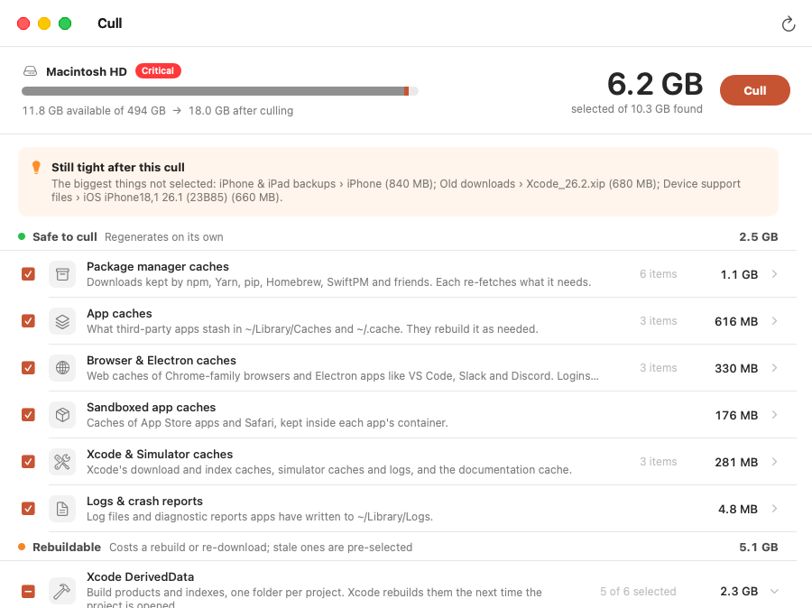

# Cull

A small native macOS app you open when the disk is getting full. It finds what the machine does not need to keep (caches, stale Xcode build data, `node_modules` in projects you have not touched in a month, old simulators), pre-selects the things that are safe, and removes them in one click.



*Taken on a CI runner against the stand-in home folder from `Scripts/make-demo-home.py`, with the disk figures simulated to show a nearly full disk.*

Requires macOS 14 or newer and Xcode (built and tested with Xcode 26.6). No Xcode project; it's a Swift package.

## Build and run

```sh
cd cull
./build.sh
open build/Cull.app
```

To put the app in `/Applications` and the `cull` command on your `PATH`:

```sh
./build.sh --install
```

`build.sh` compiles in release mode, wraps the binary in `build/Cull.app` with `Info.plist` and the icon, and signs it. If the keychain has an Apple Development or Developer ID identity it uses that, because macOS ties Full Disk Access to the signature and an ad-hoc signature changes on every build. Set `CULL_SIGN_IDENTITY=-` to force ad-hoc.

## What it finds

Everything is sorted into three tiers by what it costs you to lose it.

| Tier | What is in it | Pre-selected? |
| --- | --- | --- |
| **Safe to cull** | Package manager caches (npm, Yarn, pnpm, Bun, pip, uv, Poetry, Homebrew, SwiftPM, CocoaPods, Cargo…), third-party app caches, Chromium and Electron caches (Chrome, VS Code, Slack, Discord…), sandboxed app caches, Xcode and Simulator caches, logs, unavailable simulators, leftover IPSW firmware | Yes |
| **Rebuildable** | Xcode DerivedData per project, device support files, SwiftUI preview simulators, and `node_modules` / `.build` / `Pods` / `.venv` / `.next` / `target` in idle projects | Only when stale |
| **Your call** | Trash, old downloads and installers, simulator runtimes, simulator contents, iPhone and iPad backups, Xcode archives | Never |

"Stale" means: DerivedData not built in 14 days; a project not touched in 30 days (no file changes, no Git activity, and nothing written into the folder itself, so a project you run but never edit still counts as in use); downloads not added, changed or opened in 90 days. Dependencies are only pre-selected when a lockfile can bring them back exactly. All three are adjustable in Settings. For device support files the newest per platform is kept.

Click a row to see what is inside it. Right-click any item to show it in Finder, or choose **Never Cull This** to stop it being offered.

The bar at the top is the disk: grey is what is in use, terracotta is what the current selection would carve away.

## What it will not do

Rules decide what is worth culling. A separate safety guard, with its own lists, decides whether a path is somewhere Cull is ever allowed to delete, and both have to agree. The guard is checked again at the moment of deletion. In short:

- Nothing outside your home folder, and nothing directly inside it.
- Inside `~/Library`, only an allow list of cache, log and developer folders. Messages, Mail, Keychains, Preferences, iCloud Drive, Photos and app data are not on it.
- macOS's own caches are left alone. The exceptions are Xcode's, and the sandboxed caches of Safari, Music, Podcasts, TV, News and Maps.
- Hidden folders only by allow list (`.npm`, `.cache`, …). `.ssh`, `.config`, `.aws` and the rest are out.
- `~/Pictures`, `~/Music` and `~/Movies` are never touched.
- In every other folder of yours, exactly two things can go: a top-level item of `~/Downloads` (to the Trash only), or a folder named like a build artifact (`node_modules`, `.build`, `Pods`, `.venv`, `target`…) that sits next to the manifest proving what it is.
- Personal files (downloads, backups, archives) are moved to the Trash, never deleted.
- Symlinks are never followed. A cache folder that has been relocated through a symlink is invisible to Cull.
- It never reaches into another volume. A folder with a disk image or network share mounted inside it is not offered at all.
- Simulators are removed through `xcrun simctl`, not by deleting their folders.
- It refuses to run as root, and will only treat a folder as "home" if that folder belongs to you.

`swift test` runs the suite that holds it to this, including a test that builds a lived-in home folder, culls everything Cull offers, and checks that every precious file is still there.

## Full Disk Access

Cull works without it. With it, Cull can also see the Trash, device backups, and sandboxed app caches, and macOS stops asking about Desktop, Documents and Downloads one at a time.

System Settings › Privacy & Security › Full Disk Access › switch on Cull, then reopen it. The app has a button that opens the right pane.

## Command line

The same engine, for the terminal. It scans by default and deletes nothing until asked.

```sh
cull                        # scan and show what would be culled
```

```sh
cull --apply                # cull what is pre-selected, after asking
```

```sh
cull --apply --yes          # no questions: for scripts and Shortcuts
```

```sh
cull --apply --include rebuildable,trash    # also take the whole rebuildable tier and empty the Trash
```

```sh
cull --never ~/Developer/Archivist         # never offer anything inside this folder
```

`cull --help` lists the rest (`--only`, `--exclude`, `--stale-days`, `--roots`, `--json`, `--list`). `--include` and `--exclude` take category ids from `cull --list`, or a single item's id from `cull --json`. When run from Terminal it uses Terminal's Full Disk Access.

## Try it without risk

`Scripts/make-demo-home.py` builds a stand-in home folder full of realistic clutter (about 1 GB; pass `--scale 0.2` for about 10 GB), and `CULL_HOME` points Cull at it instead of your real one:

```sh
python3 Scripts/make-demo-home.py /tmp/cull-demo
```

```sh
CULL_HOME=/tmp/cull-demo/home CULL_DAYS_AHEAD=400 swift run cull
```

```sh
open --env CULL_HOME=/tmp/cull-demo/home --env CULL_DAYS_AHEAD=400 build/Cull.app
```

`CULL_DAYS_AHEAD` makes Cull believe time has passed, so the freshly written demo files count as stale. It only works together with `CULL_HOME`.

## Layout

- `Sources/CullCore/`: the engine, Foundation only.
  - `Rules+*.swift`: what to look for. Each rule lists candidates; it never deletes.
  - `Catalog.swift`: the rules, in the order they are shown.
  - `SafetyGuard.swift`: the independent allow list every deletion has to pass.
  - `Scanner.swift`: runs the rules, weighs what they found, decides what is pre-selected.
  - `Culler.swift`: carries out a cull, re-checking every path first.
  - `Posix.swift`: directory walking and sizing that never follows a symlink.
- `Sources/cull/`: the command-line tool.
- `Sources/CullApp/`: the SwiftUI app.
- `Tests/`: the test suites for the engine and the CLI. They run on Linux as well as macOS.
- `Scripts/make-demo-home.py`: the stand-in home folder.
- `Resources/AppIcon.svg`: icon source. `AppIcon.icns` is rendered from it.

## Adding a rule

Add a `Rule` in one of the `Rules+*.swift` files and list it in `Catalog.all` (`Catalog.swift`). If it reaches somewhere new, the safety guard will refuse it until that location is added to the guard's own allow list as well. That double entry is deliberate.

## Good to know

- With Time Machine on, macOS can hold freshly deleted space in a local snapshot for up to a day. Cull reports "available" space the way Finder does (free plus purgeable), so the number still goes up; macOS hands the space over as soon as something needs it.
- Sizes are what is allocated on disk. Where files share storage (APFS clones, which Xcode and some package managers use), the real gain can be smaller than the estimate, so the summary after a cull reports the actual change in available space.
- The first scan without Full Disk Access makes macOS ask about Desktop, Documents and Downloads. Saying no just means those folders are skipped.
- Culling something that is in use is harmless but untidy, so Cull leaves the caches of running apps unselected and says which app to quit.

## Not there yet

- DerivedData in a custom location, and projects on external drives, are not scanned.
- Docker and Ollama are reported with their size and the command that trims them, but not culled.
- Time Machine local snapshots are not handled; the "purgeable" space macOS reports is already counted as available.
